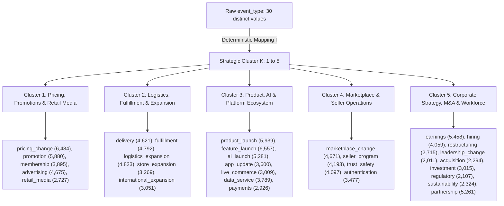

# NextMove Prediction-Target Specification

**Document Path:** `reports/prediction_target_spec.md`  
**System:** NextMove Memory-Powered Competitive Intelligence Platform  
**Target Competitors:** Amazon, Walmart, eBay  
**Temporal Span:** 2018-01-01 through 2026-10-09  
**Status:** Approved Specification (Step 3 Finalized & Audited)  
**Cutoff Convention:** Convention A (Start-of-Day Cutoff, Monday 00:00:00 UTC)  

---

## 1. Executive Summary & Recommended Primary Target

The NextMove platform monitors competitor actions and forecasts impending strategic moves to empower preemptive corporate decision-making. 

### Recommended Primary Target
**Multi-Horizon Strategic Move Likelihood (30-Day Forward Window, $W = 30$ days)**:  
> *"Given competitor $C \in \{\text{Amazon}, \text{Walmart}, \text{eBay}\}$, strategic action cluster $K \in \{1, 2, 3, 4, 5\}$, and observation cutoff Monday $T$ at 00:00:00 UTC, what is the calibrated probability $P(Y_{C, K, T} = 1 \mid \mathcal{F}_T)$ that competitor $C$ will execute at least one event in cluster $K$ during the 30-day forward window $[T, T + 29 \text{ days}]$ inclusive?"*

### Strategic Justification
1. **Executive Operational Alignment:** Competitive intelligence decision-makers operate on weekly executive briefings and monthly planning cycles. Predicting whether a competitor will execute a strategic initiative in the upcoming 30 days provides actionable commercial counter-positioning lead time.
2. **Robustness to High Event Volume:** Competitors in the monitoring ledger generate ~38 events per day in aggregate (~15 events/day for Amazon alone). Micro-classification of the immediate next individual event collapses under intra-day ties. A 30-day window aggregation cleanly resolves intra-day collisions without arbitrary tie-breaking.
3. **Strict Leak-Free Chronological Splitting:** Adopting Convention A (Monday 00:00:00 UTC) with partitioned observation cutoffs and verified embargo buffers guarantees zero temporal leakage between feature histories and future labels.
4. **Viable Synthetic Pipeline Validation:** Enables full prototyping of rolling feature stores, embargoed splits, and probability calibration routines, establishing a hardened contract for subsequent evidence-backed real-world data ingestion.

---

## 2. Complete Event Taxonomy Mapping & Cluster Assignment

### 2.1 Derivation of Strategic Clusters
The raw dataset contains the column `event_type` (30 distinct string values) and `strategic_area` (20 string values), but **does not contain a pre-existing cluster identifier or `k_e` column**. 

Each event's strategic cluster $K \in \{1, 2, 3, 4, 5\}$ is **explicitly derived** via a deterministic mapping function $f: \text{event\_type} \mapsto \text{cluster\_id}$:



### 2.2 Exhaustive Cluster Membership & Measured Row Counts
Every one of the 30 event types in the raw CSV is mapped to **exactly one** cluster with **zero unmapped or discarded rows**:

| Cluster ID | Strategic Cluster Name | Exhaustive Member Event Types | Measured Row Count | Dataset Share |
| :---: | :--- | :--- | :---: | :---: |
| **Cluster 1** | **Pricing, Promotions & Retail Media** | `pricing_change`, `promotion`, `membership`, `advertising`, `retail_media` | 23,661 | 19.55% |
| **Cluster 2** | **Logistics, Fulfillment & Expansion** | `delivery`, `fulfillment`, `logistics_expansion`, `store_expansion`, `international_expansion` | 20,556 | 16.99% |
| **Cluster 3** | **Product, AI & Platform Ecosystem** | `product_launch`, `feature_launch`, `ai_launch`, `app_update`, `live_commerce`, `data_service`, `payments` | 31,101 | 25.70% |
| **Cluster 4** | **Marketplace & Seller Operations** | `marketplace_change`, `seller_program`, `trust_safety`, `authentication` | 16,438 | 13.59% |
| **Cluster 5** | **Corporate Strategy, M&A & Workforce** | `earnings`, `hiring`, `restructuring`, `leadership_change`, `acquisition`, `investment`, `regulatory`, `sustainability`, `partnership` | 29,244 | 24.17% |
| **Total** | **All 5 Clusters** | **All 30 Distinct Event Types** | **121,000** | **100.00%** |

*Verification:* Directly measured from `recall_intel_121000_independent_synthetic_events.csv`. $\sum \text{Rows} = 121,000$.

---

## 3. Label Construction & Boundary Protocol (Convention A)

### 3.1 Prediction Cutoff Convention: Start-of-Day (Monday 00:00:00 UTC)
NextMove standardizes on **Convention A**:
- **Cutoff Timestamp:** Every weekly Monday at `00:00:00 UTC` ($T$). Predictions are issued before business/trading opens on Monday.
- **Historical Feature Date Boundary:** Only events with $\text{event\_date} \le T_{\text{date}} - 1 \text{ day}$ (completed historical days through Sunday 23:59:59 UTC) are eligible for feature extraction. Events occurring on Monday have not yet occurred at cutoff time and are strictly excluded from features.
- **Forward Label Window:** Exactly **30 full calendar days**, starting on Monday $T_{\text{date}}$ (day 1) and ending on Tuesday $T_{\text{date}} + 29 \text{ days}$ (day 30) inclusive:
  $$\text{Label Window} = [T_{\text{date}}, T_{\text{date}} + 29 \text{ days}]$$
- **Disjointness Invariant:** $\text{Feature Dates} \le T_{\text{date}} - 1 < T_{\text{date}} \le \text{Label Dates}$. Feature and label dates share **zero** overlapping days.

### 3.2 Formal Binary Label Definition
For cutoff Monday $T_{\text{date}}$, competitor $C \in \{\text{Amazon}, \text{Walmart}, \text{eBay}\}$, and strategic cluster $K \in \{1, 2, 3, 4, 5\}$:

$$Y_{C, K, T} = \begin{cases} 
1 & \text{if } \sum_{e \in \mathcal{E}} \mathbb{I}(c_e = C \land f(\text{event\_type}_e) = K \land T_{\text{date}} \le t_e \le T_{\text{date}} + 29) \ge 1 \\
0 & \text{if } \sum_{e \in \mathcal{E}} \mathbb{I}(c_e = C \land f(\text{event\_type}_e) = K \land T_{\text{date}} \le t_e \le T_{\text{date}} + 29) = 0
\end{cases}$$

### 3.3 Edge Cases & Guard Rules
1. **Zero-Event Windows (Valid Negative Labels):** A forward window containing zero matching events for competitor $C$ in cluster $K$ is completely valid and produces label `0`. Testing label bounds must evaluate the query interval $[T_{\text{date}}, T_{\text{date}} + 29]$ independently of event presence.
2. **Right-Censored Incomplete Forward Windows:** Any cutoff where $T_{\text{date}} + 29 > \text{2026-10-09}$ ($T_{\text{date}} > \text{2026-09-10}$) has an incomplete 30-day window. Truncated windows cause false-negative bias and are **strictly forbidden**. The last allowable observation cutoff is **Monday, 2026-09-07**.
3. **Intra-Day Event Collisions:** If multiple events in cluster $K$ occur on the same day for competitor $C$, the label remains binary `1`.
4. **Cross-Sectional Window Overlap:** Adjacent weekly cutoffs ($T, T+7$) naturally overlap by 23 days in their forward labels. This is standard rolling-window panel structure. It does **not** constitute temporal leakage as long as partition cutoff boundaries and embargoes are maintained.

---

## 4. Point-in-Time Features & Recency Protocol

### 4.1 Strict Temporal Boundaries
The feature store representation $\mathcal{F}_T$ for cutoff Monday $T_{\text{date}}$ at 00:00:00 UTC enforces:
$$\mathcal{F}_T = \{ e \in \mathcal{E} \mid t_e \le T_{\text{date}} - 1 \text{ day} \}$$
Under no circumstances may any transformation query events where $t_e \ge T_{\text{date}}$.

### 4.2 Lookback Features Specification & Recency Sentinel

| Feature Group | Feature Name | Definition | Lookback Interval |
| :--- | :--- | :--- | :--- |
| **Recency Duration** | `days_since_last_cluster_event` | $(T_{\text{date}} - 1) - \max(\{t_e \le T_{\text{date}} - 1 \mid c_e=C, f(\text{type}_e)=K\})$ | Historical ($\le T_{\text{date}} - 1$) |
| **Recency Indicator** | `has_prior_cluster_event` | Binary flag: `1` if at least one prior event exists before $T_{\text{date}}$, else `0` | Historical ($\le T_{\text{date}} - 1$) |
| **Velocity (30d)** | `cluster_event_count_30d` | $\sum \mathbb{I}(c_e = C, f(\text{type}_e) = K, T_{\text{date}} - 30 \le t_e \le T_{\text{date}} - 1)$ | 30 days |
| **Velocity (90d)** | `cluster_event_count_90d` | $\sum \mathbb{I}(c_e = C, f(\text{type}_e) = K, T_{\text{date}} - 90 \le t_e \le T_{\text{date}} - 1)$ | 90 days |
| **Baseline (365d)** | `cluster_event_count_365d` | $\sum \mathbb{I}(c_e = C, f(\text{type}_e) = K, T_{\text{date}} - 365 \le t_e \le T_{\text{date}} - 1)$ | 365 days |
| **Momentum Ratio** | `velocity_ratio_30_90` | $(\text{count\_30d} + 1) / (\text{count\_90d}/3 + 1)$ | 90 days |
| **Rival Velocity** | `rival_event_count_14d` | $\sum \mathbb{I}(c_e \ne C, f(\text{type}_e) = K, T_{\text{date}} - 14 \le t_e \le T_{\text{date}} - 1)$ | 14 days |
| **Decayed Mass** | `decayed_magnitude_mass_60d`| $\sum m_e \cdot \exp(-0.05 \cdot (T_{\text{date}} - 1 - t_e))$ over last 60 days | 60 days |
| **Calendar Context**| `quarter`, `month`, `is_q4` | Calendar extractions from date $T_{\text{date}}$ | Exogenous |

#### Rigorous Recency Sentinel Specification
To avoid conflating unobserved history with a genuine long elapsed duration (e.g. 999 days):
- If **at least one prior event exists** in history ($t_e \le T_{\text{date}} - 1$):  
  `has_prior_cluster_event = 1` and `days_since_last_cluster_event = (T_{\text{date}} - 1) - \max(t_e)`.
- If **no prior event exists** in history:  
  `has_prior_cluster_event = 0` and `days_since_last_cluster_event = -1.0` (standardized negative sentinel). Tree-based models partition cleanly on the binary flag, avoiding false numerical distance.

### 4.3 Date-Only Point-in-Time Limitations
Date-only records permit rigorous **calendar-day boundary control** ($\le T_{\text{date}} - 1$), but **cannot establish the exact intra-day public availability time** of a disclosure. Because disclosures occurring over the weekend or late Friday may experience publication, crawling, or indexing delays in live operations, date-only data does not guarantee that weekend announcements were publicly accessible prior to Monday 00:00 UTC. In production competitive intelligence, real-world forecasting claims require immutable publication timestamps (`published_at`) or crawling ingestion timestamps (`ingested_at`). For this prototype, Convention A enforces strict calendar-day boundaries ($\le T_{\text{date}} - 1$) as a formal date-level contract, acknowledging that actual point-in-time public availability cannot be established from calendar dates alone.

### 4.4 Training-Only Preprocessing Protocol
To prevent global distribution leakage:
- All scalers (`StandardScaler`), imputer statistics (medians, modes), and categorical encoders must be **fit strictly on the Training partition cutoffs** ($T \le T_{\text{train\_end}}$) and applied out-of-sample to Validation and Test partitions.
- No global dataset parameters may be computed over the entire timeline.

---

## 5. Chronological Partition Schedule & Embargo Design

### 5.1 Distinguishing Cutoff Embargos vs. Label-to-Cutoff Gaps
To prevent terminology confusion:
- **Cutoff Embargo Interval:** The span of calendar dates during which **no observation cutoffs are sampled**.
- **Label-to-Cutoff Buffer Gap:** The elapsed calendar days between the **last label date of partition $N$** and the **first prediction cutoff date of partition $N+1$**.

```
[------------- TRAIN -------------] [CUTOFF EMBARGO 1] [---------- VALIDATION ----------] [CUTOFF EMBARGO 2] [------------- TEST -------------]
2018-01-01              2023-11-27      34 Days        2024-01-01              2025-05-26      41 Days        2025-07-07              2026-09-07
Label Window up to:     2023-12-26  [5-day label gap]  Label Window up to:     2025-06-24  [12-day label gap] Label Window up to:     2026-10-06
```

### 5.2 Partition Schedule Matrix (445 Eligible Mondays)

| Partition | Start Cutoff $T_{\text{start}}$ | End Cutoff $T_{\text{end}}$ | Max Feature Date | Max Label Date Observed | Eligible Mondays | Supervised Instances (3 comp $\times$ 5 clusters) |
| :--- | :---: | :---: | :---: | :---: | :---: | :---: |
| **Train** | `2018-01-01` | `2023-11-27` | `2023-11-26` | `2023-12-26` | 309 | 4,635 |
| **Cutoff Embargo 1** | `2023-11-28` | `2023-12-31` | N/A | *Blackout creates 5-day gap to Val cutoff* | 0 | 0 |
| **Validation** | `2024-01-01` | `2025-05-26` | `2025-05-25` | `2025-06-24` | 74 | 1,110 |
| **Cutoff Embargo 2** | `2025-05-27` | `2025-07-06` | N/A | *Blackout creates 12-day gap to Test cutoff* | 0 | 0 |
| **Test (OOT)** | `2025-07-07` | `2026-09-07` | `2026-09-06` | `2026-10-06` | 62 | 930 |
| **Total Grid** | | | | | **445 Mondays** | **6,675 instances** |

### 5.3 Mathematical Zero-Overlap Proof
1. **Train $\to$ Validation:** Last train label date is `2023-12-26`. First validation cutoff is `2024-01-01`. The actual gap is **5 full calendar days** (`2023-12-27` through `2023-12-31`). Zero training labels overlap validation evaluation.
2. **Validation $\to$ Test:** Last validation label date is `2025-06-24`. First test cutoff is `2025-07-07`. The actual gap is **12 full calendar days** (`2025-06-25` through `2025-07-06`). Zero validation labels overlap test evaluation.
3. **Dataset Boundary Completion:** The final test label date is `2026-10-06`, which is 3 days prior to the maximum dataset date of `2026-10-09`. There are **zero incomplete or right-censored test windows**.

---

## 6. Baseline Models & Performance Evaluation Framework

To determine whether machine learning adds value, candidate models must be evaluated against two formally specified benchmark baselines on the **exact same 930 eligible test-partition instances**:

### 6.1 Baseline 1: Historical Base-Rate Predictor (Stationary Prior)
- **Formulation:** Computes the empirical positive prevalence observed across the training partition labels:
  $$\hat{p}_{\text{base}}(C, K) = \frac{1}{|T_{\text{train}}|} \sum_{T \in T_{\text{train}}} Y_{C, K, T}$$
- **Interpretation & Caveats:** 
  - A constant-score predictor produces an Average Precision equal to the **test-set empirical positive prevalence** ($\pi_{\text{test}}$).
  - The training base rate is **not a guaranteed performance floor**; if test prevalence shifts from training prevalence, Brier Score and log-loss can degrade. Actual test-set prevalence must be reported alongside baseline results.

### 6.2 Baseline 2: Trailing-Momentum Predictor (Constant-Rate Poisson Approximation)
- **Formulation:** Approximates event arrival as a stationary Poisson process over the trailing 90 days $[T_{\text{date}} - 90, T_{\text{date}} - 1]$:
  $$\hat{\lambda}_{C, K, T} = \frac{\sum_{t_e \in [T_{\text{date}}-90, T_{\text{date}}-1]} \mathbb{I}(c_e = C \land f(\text{type}_e) = K)}{90}$$
  $$\hat{p}_{\text{momentum}}(C, K, T) = 1 - \exp\left(-30 \cdot \hat{\lambda}_{C, K, T}\right)$$
- **Interpretation & Caveats:** 
  - On memoryless synthetic data or during sudden strategic regime changes, momentum is not mathematically guaranteed to beat base rate. It serves as an **empirical trend benchmark**, not an assumed winner.

### 6.3 Evaluation Metrics and Target Success Criteria
All criteria are **aspirational performance goals**, not verified outcomes:

| Evaluation Metric | Mathematical Formulation | Target Success Goal (Aspirational) | Practical Operational Meaning |
| :--- | :--- | :--- | :--- |
| **PR-AUC (Average Precision)** | $\sum_n (R_n - R_{n-1}) P_n$ | **$\text{PR-AUC}_{\text{model}} > \max(\text{PR-AUC}_{\text{base}}, \text{PR-AUC}_{\text{momentum}})$** | Evaluates ranking precision on positive strategic moves; robust to imbalance. |
| **Brier Score (BS)** | $\frac{1}{N} \sum_{i=1}^N (\hat{p}_i - y_i)^2$ | **$\text{BSS} = 1 - \frac{\text{BS}_{\text{model}}}{\text{BS}_{\text{base}}} > 0$** | Brier Skill Score must be positive, demonstrating superior probability forecasting. |
| **Expected Calibration Error (ECE)** | $\sum_{m=1}^{10} \frac{|B_m|}{N} |\text{acc}(B_m) - \text{conf}(B_m)|$ | **$\text{ECE}_{\text{model}} < 0.05$ (5%)** | Ensures predicted probabilities match empirical observation frequencies. |
| **Precision @ Confidence $p \ge 0.70$** | $\frac{\text{TP}_{p \ge 0.70}}{\text{TP}_{p \ge 0.70} + \text{FP}_{p \ge 0.70}}$ | **$\text{Precision}_{\text{model}} \ge 0.80$ (80%)** | Minimizes expensive false alarms on executive intelligence dashboards. |

---

## 7. Synthetic Experimentation vs. Evidence-Backed Reality

NextMove strictly enforces the separation of synthetic benchmarks and real-world ground truth:

```mermaid
graph LR
    subgraph Synthetic Harness [data/synthetic/]
        S1[Feature Store Pipeline Engine]
        S2[Point-in-Time Rolling Joins]
        S3[Leakage Defense Fixtures]
        S4[Calibration & Baseline Scripts]
    end
    
    subgraph Evidence Engine [data/evidence/]
        E1[Verified Public Disclosures]
        E2[Causal Competitor Retaliation Loops]
        E3[Macroeconomic Shocks & Seasonality]
        E4[Production CI Forecasts]
    end
    
    Synthetic Harness -.->|Pipeline Contracts Only| Evidence Engine
```

### Functional Separation Matrix

| Capability / Concern | Synthetic Dataset Harness (`data/synthetic/`) | Evidence-Backed Real-World Engine (`data/evidence/`) |
| :--- | :--- | :--- |
| **Scope of Validation** | **Validates pipeline mechanics only:** Feature calculation speed, point-in-time join logic, chronological partitioning, embargo enforcement, and calibration mathematics. | **Validates genuine predictive intelligence:** Authentic competitor retaliation lags, real macro shocks, and non-random strategic sequence transitions. |
| **Predictive Skill Claims** | **NO CLAIM OF REAL PREDICTIVE SKILL.** Models trained on synthetic data cannot demonstrate real-world edge because synthetic features are statistically uncoupled (correlations $\approx 0.000$) and template-generated. | **EVALUATES TRUE PREDICTIVE EDGE.** Production models must demonstrate statistically significant outperformance over the trailing-momentum baseline. |
| **Pacing & Arrival Signals** | Flat, memoryless ~38 events/day rate without seasonality. | Organic corporate disclosure rhythms (earnings seasons, product release cycles, holiday peaks). |
| **Provenance Tracking** | Static flag (`source_type = 'synthetic'`). Excluded from feature store. | Cryptographic verification hashes, source URLs, regulatory filing IDs, and fact-extraction confidence weights. |

---

## 8. Automated Leakage-Test Requirements (`tests/temporal_leakage/`)

Prior to model training, the pipeline must pass four automated temporal integrity tests:

1. **`test_feature_temporal_boundary_convention_a`:** Asserts that for every sample point with cutoff Monday $T_{\text{date}}$, the feature query interval is strictly bounded by $[\text{start}, T_{\text{date}} - 1]$. Asserts that if an event with $t_e \ge T_{\text{date}}$ is artificially injected, it is excluded from the feature vector.
2. **`test_label_window_temporal_bounds`:** Asserts that the label generation function defines the query interval strictly as $[T_{\text{date}}, T_{\text{date}} + 29]$ independently of event presence. Asserts that an empty event set produces label `0`, and an injected event at $T_{\text{date}} - 1$ or $T_{\text{date}} + 30$ does not flip the label to `1`.
3. **`test_partition_embargo_isolation`:** Asserts that $\max(t_{\text{label\_train}}) < \min(T_{\text{val\_cutoff}})$ (asserting the 5-day label gap) and $\max(t_{\text{label\_val}}) < \min(T_{\text{test\_cutoff}})$ (asserting the 12-day label gap).
4. **`test_no_truncated_test_windows`:** Asserts that zero observation cutoffs are sampled after `2026-09-07`, ensuring 100% of test instances have full 30-day forward ground-truth visibility.
